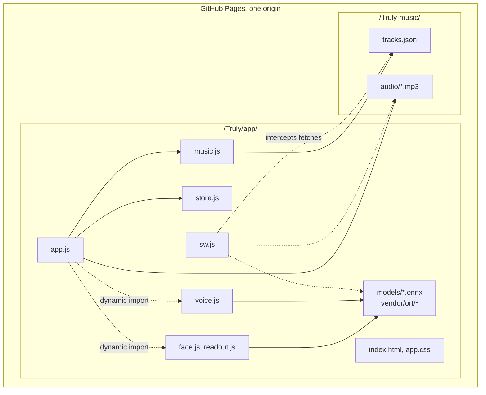
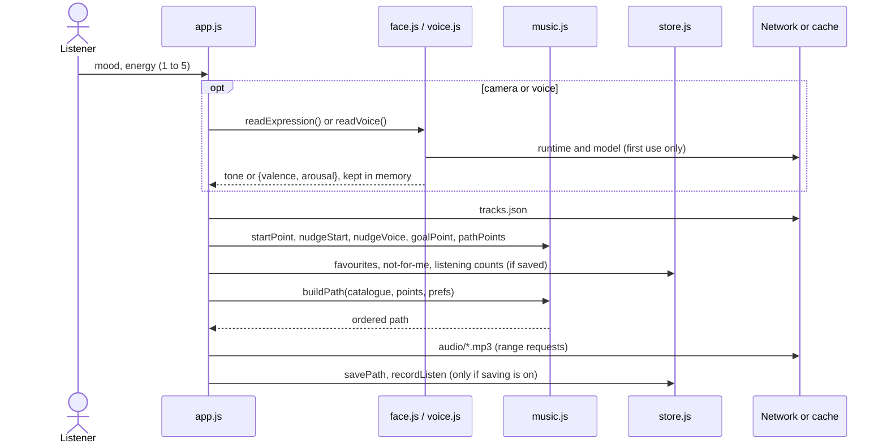
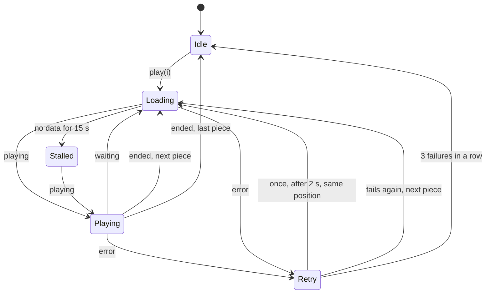

# Truly: technical design

This document describes how Truly is built: the system structure, the recommendation algorithm, the two on-device models and how they were trained, the browser runtime, client-side state, and the reasons behind the main design choices. It is written for engineers and machine learning practitioners who want to understand, verify or extend the code. A rendered version with live examples is at [hashtagrr.github.io/Truly/how-it-works.html](https://hashtagrr.github.io/Truly/how-it-works.html).

## Contents

1. [Overview](#1-overview)
2. [System structure](#2-system-structure)
3. [Catalogue and notation](#3-catalogue-and-notation)
4. [Recommendation engine](#4-recommendation-engine)
5. [On-device inference runtime](#5-on-device-inference-runtime)
6. [Face pipeline](#6-face-pipeline)
7. [Voice pipeline](#7-voice-pipeline)
8. [Export and verification](#8-export-and-verification)
9. [Client state and storage](#9-client-state-and-storage)
10. [Playback and offline use](#10-playback-and-offline-use)
11. [Testing](#11-testing)
12. [Design decisions](#12-design-decisions)
13. [Code map and extension points](#13-code-map-and-extension-points)

## 1. Overview

Truly maps a listener's self-reported mood and energy to a point in valence and arousal space, plans a straight line from that point to a goal chosen by direction, and fills the line with recordings whose published valence, arousal and tempo place them close to it. Two optional models, a face expression model and a voice model, may shift the start point by a small, bounded amount. Everything runs in the browser.

| | |
|---|---|
| Hosting | Static files on GitHub Pages; no server code |
| Client | Plain ES modules, no build step, no framework |
| Recommendation | Geometry, a cost function and weighted sampling, in `music.js` |
| Models | Two ONNX models distilled from LAION teachers, run with ONNX Runtime Web (WebAssembly) |
| Face model | EfficientNet-B0, 4.06 M parameters, 16.2 MB, 224 × 224 input, 40 outputs |
| Voice model | Log-mel CNN, 420,410 parameters, 2.4 MB, 80,000-sample input, 2 outputs |
| State | In memory per visit; optional `localStorage`, off by default |
| Offline | Service worker caching public files only |

### Constraints that shape the design

| Constraint | Consequence |
|---|---|
| Static hosting, no backend | All computation in the client; models in ONNX; catalogue as a JSON file |
| No personal data leaves the device | No analytics or third-party requests; recordings self-hosted; inference on device |
| Non-clinical scope | Models only adjust a start point; no output is shown as a reading of the person; mood answers never stored |
| Phones as the main target | Small models, lazy loading, single-threaded WebAssembly, offline support |
| Small catalogue (18 recordings) | Quantile-based placement of answers; candidate pooling; forward re-ordering of paths |

## 2. System structure

### Components



| Module | Responsibility | Depends on |
|---|---|---|
| `app.js` | Views, event wiring, session state, player, preferences, history | `music.js`, `store.js`; lazily `face.js`, `voice.js` |
| `music.js` | Pure recommendation functions: placement, goals, planning, cost, selection, swaps, nudges, explanations, quality metrics | none |
| `store.js` | The only module that touches `localStorage` | none |
| `face.js`, `readout.js` | Camera capture, face detection, face model, readout to a tone | ONNX Runtime Web |
| `voice.js` | Microphone capture, resampling, loudness normalisation, voice model, readout | ONNX Runtime Web |
| `sw.js` | Caching for offline use | none |

`music.js`, `readout.js` and `store.js` have no DOM dependencies and run unchanged in Node.js, which is how they are tested.

### Request flow of one session



## 3. Catalogue and notation

### Catalogue

`tracks.json` in the Truly-music repository lists every recording:

| Field | Type | Meaning |
|---|---|---|
| `key` | string | Stable identifier, also the audio file name |
| `title`, `composer`, `performer` | string | Credits |
| `instruments` | string[] | Any of `piano`, `strings`, `orchestra`, `winds` |
| `audio` | string | Relative path to a 96 kbps MP3, loudness-normalised |
| `seconds` | number | Duration |
| `valence`, `arousal` | number | From MCUD 1.0 (Du et al., 2026), averaged when a recording covers several entries |
| `bpm` | number or null | Tempo from MCUD 1.0 |
| `licence`, `licence_url`, `source` | string | Licence and Wikimedia Commons page |
| `mcud` | number[] | MCUD 1.0 song identifiers |

### Notation

A piece $s$ has position $(v_s, a_s)$. The catalogue's valence and arousal values have standard deviations $\sigma_V$ and $\sigma_A$ and empirical quantile functions $Q_V$ and $Q_A$. All distances are measured in standardised units:

$$
d(x, y) = \sqrt{\left(\frac{v_x - v_y}{\sigma_V}\right)^2 + \left(\frac{a_x - a_y}{\sigma_A}\right)^2}
$$

so that one step of mood and one step of energy weigh the same, whatever the scales of the source annotations.

## 4. Recommendation engine

All functions below are in `docs/app/music.js` and are pure: the same inputs and random source give the same path.

### 4.1 Start point

Each answer $\ell \in \{1, \dots, 5\}$ selects a quantile level $q_\ell \in (0.08, 0.25, 0.50, 0.75, 0.92)$:

$$
p_0 = (Q_V(q_{\ell_\text{mood}}),\; Q_A(q_{\ell_\text{energy}}))
$$

Placing answers by quantile of the catalogue, rather than by a fixed mapping to the annotation scale, keeps every answer inside the region where recordings exist.

### 4.2 Optional nudges

The camera result is a tone $\tau \in \{\text{bright}, \text{calm}, \text{heavy}\}$ and moves valence only:

$$
v_0 \leftarrow v_0 + 0.35\,\sigma_V \cdot \begin{cases} +1 & \tau = \text{bright} \\ 0 & \tau = \text{calm} \\ -1 & \tau = \text{heavy} \end{cases}
$$

The voice result $(\hat v, \hat a)$ is in standard deviations from everyday speech (section 7.6). With $c(x) = \max(-1, \min(1, x / 1.5))$:

$$
v_0 \leftarrow v_0 + 0.12\,\sigma_V\, c(\hat v), \qquad a_0 \leftarrow a_0 + 0.40\,\sigma_A\, c(\hat a)
$$

Both nudges are bounded so the listener's answers always dominate.

### 4.3 Goal

| Direction | Goal valence $v_g$ | Goal arousal $a_g$ |
|---|---|---|
| calmer | $v_0 + 0.4\,(\max(v_0, Q_V(0.55)) - v_0)$ | $\min(a_0, Q_A(0.25))$ |
| brighter | $\max(v_0, Q_V(0.70))$ | $a_0 + 0.4\,(Q_A(0.45) - a_0)$ |
| steady | $v_0$ | $a_0$ |

The default direction is `steady` when mood $\ge 4$, `calmer` when mood $\le 2$ and energy $\ge 4$, and `brighter` otherwise. The listener can always override it.

### 4.4 Planned points

For a path of $n$ pieces (4, 6 or 9; "slow down" uses $\mathrm{round}(1.5\,n)$ and keeps the first piece):

$$
p_i = p_0 + \frac{i}{n - 1}\,(p_g - p_0), \qquad i = 0, \dots, n - 1
$$

The heading $h$ is the unit vector from $p_0$ to $p_g$ in standardised units, and is undefined for `steady`. Starting near the listener's state and moving gradually follows the iso principle (Heiderscheit and Madson, 2015; Starcke and von Georgi, 2024).

### 4.5 Cost of a candidate

For candidate $s$ at planned point $p_i$, with previous piece $r$ and $\Delta$ the standardised step from $r$ to $s$:

$$
\begin{aligned}
C(s) ={}& d(s, p_i)^2 && \text{closeness} \\
&+ 0.35\,\lVert \Delta \rVert^2 && \text{small step} \\
&+ 1.0\,\min(0,\, \Delta \cdot h)^2 && \text{no backward movement} \\
&+ 0.3\left(\frac{\text{bpm}_s - \text{bpm}_r}{30}\right)^2 && \text{gradual tempo} \\
&+ 0.6\,[\,\text{no preferred instrument}\,] \\
&- 0.25\,[\,\text{favourite}\,] \\
&- 0.24\,\lambda_s && \text{listening history}
\end{aligned}
$$

$[\cdot]$ is 1 when the condition holds, and $\lambda_s \in [-1, 1]$ is the clipped difference between full plays and early skips of $s$, divided by 3 (section 9). Terms that involve $r$ are zero for the first piece. `cost()` returns every term separately; the website uses this to plot why a piece was chosen.

### 4.6 Selection

```
buildPath(catalogue, points, keep, prefs, rng):
    path ← keep
    for each planned point p_i not covered by keep:
        candidates ← pieces not in path, performer not in path, not ruled out
        K ← the 8 candidates with the lowest C(s)
        pool ← members of K with rank < 4 and C ≤ C_min + 0.25
        choose from pool with weights 1 / (1 + rank)²    # 1, 1/4, 1/9, 1/16
        append the choice to path
    return path sorted by (v_s/σ_V, a_s/σ_A) · h          # forward order
```

Sampling among near-ties varies paths between sessions without choosing poor matches. The final sort guarantees monotone progress along the heading, even when a later point selected a piece slightly behind an earlier one.

`replaceSong` repeats the choice for one index, first restricted to candidates whose projection on $h$ lies between the neighbours' projections, then without that bound, and sorts the path again.

### 4.7 Explanations

For piece $i > 0$, the standardised differences from piece $i - 1$ are compared with $\pm 0.15$: arousal gives "calmer" or "livelier", valence "brighter" or "more reflective". The first piece "matches the mood and energy you described"; the last piece of a moving path "is where the path settles". A note is added for a favourite, a matching preferred instrument, or $\lambda_s \ge 2/3$.

### 4.8 Path quality

`pathQuality(path)` reports, over the standardised steps $\lVert \Delta_j \rVert$ between neighbours:

| Metric | Definition |
|---|---|
| Average step | $\bar\delta = \mathrm{mean}_j \lVert \Delta_j \rVert$ |
| Largest step | $\max_j \lVert \Delta_j \rVert$ |
| Step variation | $\mathrm{sd}_j \lVert \Delta_j \rVert \,/\, \bar\delta$; 0 when all steps are equal |
| Largest tempo change | $\max_j \lvert \text{bpm}_{j+1} - \text{bpm}_j \rvert$ |

These follow the smoothness and evenness criteria used for mood playlists (Donnelly and Gaur, 2022). Measured over all 25 answer pairs, 3 directions, 3 lengths and 5 random seeds (1,125 paths) with the current catalogue:

| Metric | Median | 90th percentile | Maximum |
|---|---|---|---|
| Average step | 0.48 | 0.80 | 1.12 |
| Largest step | 0.92 | 1.84 | 2.01 |
| Step variation | 0.68 | 0.99 | 1.24 |
| Largest tempo change (bpm) | 21 | 40 | 44 |

The tests fail if any path exceeds a largest step of 2.2, an average step of 1.2 or a tempo change of 45 bpm.

## 5. On-device inference runtime

| | |
|---|---|
| Runtime | ONNX Runtime Web 1.30.0, WebAssembly backend with SIMD (`ort-wasm-simd-threaded.wasm`, 14.2 MB) |
| Threads | 1 (`ort.env.wasm.numThreads = 1`) |
| Loading | Runtime and models load through dynamic `import()` only when the camera or voice is first used |
| Caching | Service worker, cache first after the first download |

GitHub Pages cannot send the `Cross-Origin-Opener-Policy` and `Cross-Origin-Embedder-Policy` headers needed for `SharedArrayBuffer`, so multi-threaded WebAssembly is unavailable; one thread is set explicitly to avoid a failed attempt.

Inference time, median of five runs after one warm-up, on one thread of a 2.2 GHz Xeon in Node.js 20 with the same runtime:

| Model | Input | Size | Time per run |
|---|---|---|---|
| UltraFace RFB-320 | 1 × 3 × 240 × 320 | 1.3 MB | 377 ms |
| Truly face model v1 | 1 × 3 × 224 × 224 | 16.2 MB | 191 ms |
| Truly voice model v1 | 1 × 80,000 | 2.4 MB | 132 ms |

## 6. Face pipeline

### 6.1 Inference


1. **Detection.** A frame is drawn to a 320 × 240 canvas, normalised as $(x - 127)/128$ per channel, and passed to UltraFace RFB-320 (MIT licence). Its outputs are face probabilities for 4,420 anchors and decoded boxes in normalised corner coordinates. Only the highest-scoring box above 0.7 is used, so no non-maximum suppression is needed.
2. **Crop.** A square of side $1.5 \max(w, h)$ around the box centre is resampled to 224 × 224 and normalised with the ImageNet mean $(0.485, 0.456, 0.406)$ and standard deviation $(0.229, 0.224, 0.225)$.
3. **Model.** EfficientNet-B0, initialised from `timm` `efficientnet_b0.ra_in1k`, with its classifier replaced by a 1280 → 40 linear layer. The 40 outputs are the EmoNet-Face categories in alphabetical order.
4. **Sampling.** Up to 30 attempts 0.4 s apart collect at most 10 frames with a detected face; fewer than 3 frames gives no result.

### 6.2 Readout

With model output $z \in \mathbb{R}^{40}$ and per-category training statistics $\mu, \sigma$ from `readout.json`:

$$
r = z \odot \sigma + \mu, \qquad
g_k = \frac{1}{\lvert G_k \rvert} \sum_{c \in G_k} r_c \;\; (k \ne \text{neutral}), \qquad
g_\text{neutral} = -\max_{k \ne \text{neutral}} g_k
$$

$G_k$ are the categories mapped to expression class $k$ in `mappings/emonet_categories.json`. Class scores are averaged over frames, calibration offsets $b$ are added, and $\hat k = \arg\max_k (\bar g_k + b_k)$. Happy and surprise map to the tone *bright*; angry, disgust, fear and sad to *heavy*; neutral to *calm*.

### 6.3 Training by distillation

| | |
|---|---|
| Teacher | Empathic-Insight-Face-Large: 40 MLP heads (1152 → 1024 → 512 → 256 → 1, ReLU, dropout 0.2) on SigLIP 2 so400m patch16-384 image embeddings (1152-d); about 470 M parameters in total |
| Student | EfficientNet-B0 with a 40-output head, 4.06 M parameters |
| Data | 79,999 face images: 40,000 FairFace, 20,000 EmoNet-Face Big, 19,999 EmoNet-Face Binary; 76,000 train, 3,999 validation |
| Targets | Teacher scores for all 40 categories, standardised per category |
| Loss | Smooth L1 ($\beta = 1$) |
| Optimiser | AdamW, weight decay 0.02; one-cycle learning rate, peak $10^{-3}$, 10% warm-up; batch 128; 8 epochs; mixed precision |
| Augmentation | Random square crop of 80 to 100%, horizontal flip (0.5), rotation of ±10°, greyscale (0.25), downscale to 48, 64 or 96 px and back (0.25), brightness × U(0.8, 1.2) plus U(−0.2, 0.2) on normalised pixels |
| Compute | Two NVIDIA T4 GPUs on Kaggle, 31.8 minutes including evaluation |

No FER-2013 data was used for training or calibration. The same network trained directly on EmoNet-Face Binary expert labels reached 30.7% on FER-2013 PrivateTest; distillation from the teacher's dense 40-dimensional scores reached 51.0%.

### 6.4 Calibration

The offsets $b \in \mathbb{R}^7$ are fitted by coordinate ascent on CREMA-D video frames from actors with even identifiers, maximising macro F1 over the classes present: four rounds over the classes, each searching a 61-point grid on $[-3\,\mathrm{sd}(g), 3\,\mathrm{sd}(g)]$. Surprise does not occur in CREMA-D and keeps $b = 0$.

### 6.5 Evaluation

| Test set | Images | Accuracy | Macro F1 |
|---|---|---|---|
| FER-2013 PrivateTest | 3,589 | 51.0% | 0.422 |
| FER+ PrivateTest | 3,350 | 59.5% | 0.461 |
| CREMA-D frames, odd actors | 7,066 | 36.2% | 0.376 |

Chance for seven classes is 14.3%. On EmoNet-Face HQ (2,500 images, four expert ratings per category) the mean Spearman correlation with expert intensity is 0.458, and the mean AUROC for categories rated 2 or higher is 0.793. Per-class results are in the [face model card](../models/face/MODEL_CARD.md).

## 7. Voice pipeline

### 7.1 Capture

`getUserMedia` is called with `echoCancellation: true`, `noiseSuppression: false` and `autoGainControl: false`, so the signal keeps its natural dynamics. A `ScriptProcessorNode` with 4,096-frame buffers collects $5 f_s$ samples at the device rate $f_s$, and the stream stops immediately afterwards. An `OfflineAudioContext` resamples to 16 kHz and the first 80,000 samples are kept.

### 7.2 Loudness normalisation

Applied identically in training (`voice_teacher.py`) and in the browser (`voice.js`). For a signal $x$ split into 400-sample frames with RMS values $e_t$:

$$
L = \{\, t : e_t > \max(10^{-4},\, 0.1 \max_t e_t) \,\}, \qquad
\gamma = \frac{0.05}{\sqrt{\mathrm{mean}_{t \in L}\, e_t^2}}, \qquad
\gamma \leftarrow \min\!\left(\gamma,\, \frac{0.99}{\max \lvert x \rvert}\right)
$$

The output is $\gamma x$, zero-padded or cut to 80,000 samples. If $\max_t e_t < 0.002$ the clip is rejected as silence. Normalising over the sounding frames only makes the level independent of pauses, and removes distance to the microphone as a source of variation.

### 7.3 Model

The spectrogram is computed inside the network, so the ONNX graph takes raw samples.

| Stage | Operation | Output shape | Parameters |
|---|---|---|---|
| Input | 5 s at 16 kHz | 1 × 80,000 | |
| DFT | `Conv1d`, 402 fixed filters of length 400, stride 160 | 1 × 402 × 498 | fixed buffer |
| Power | $\text{re}^2 + \text{im}^2$ | 1 × 201 × 498 | |
| Mel | fixed 64 × 201 Slaney filter bank, 50 Hz to 8 kHz | 1 × 64 × 498 | fixed buffer |
| Log, standardise | $\log(x + 10^{-6})$, then zero mean and unit variance per clip | 1 × 1 × 64 × 498 | |
| Block 1 | 2 × (3 × 3 conv, batch norm, ReLU), 2 × 2 max pool | 1 × 24 × 32 × 249 | 5,496 |
| Block 2 | same | 1 × 48 × 16 × 124 | 31,296 |
| Block 3 | same | 1 × 96 × 8 × 62 | 124,800 |
| Block 4 | same | 1 × 128 × 4 × 31 | 258,560 |
| Pool | global average over frequency and time | 1 × 128 | |
| Head | dropout 0.2, linear | 1 × 2 | 258 |
| Total | | | 420,410 |

The DFT filters are

$$
W_k[n] = w[n] \cos\!\left(\frac{2\pi k n}{400}\right), \qquad
W_{201 + k}[n] = -w[n] \sin\!\left(\frac{2\pi k n}{400}\right), \qquad k = 0, \dots, 200
$$

with the periodic Hann window $w[n] = 0.5 - 0.5\cos(2\pi n / 400)$. Writing the short-time Fourier transform as a strided convolution uses only standard ONNX operators (`Conv`, `Mul`, `Add`, `MatMul`, `Log`), which every ONNX Runtime backend supports. Per-clip standardisation of the log-mel image removes any level offset left after section 7.2.

### 7.4 Teacher

Empathic-Insight-Voice-Small provides one regression head per attribute on BUD-E-Whisper encoder states. The audio is padded to Whisper's 30-second window, giving 1,500 × 768 hidden states; each head flattens them and applies 1,152,000 → 64 → 64 → 32 → 16 → 1 with ReLU. Only the Valence and Arousal heads are downloaded and run; no other attribute is ever computed. With the encoder, the teacher has about 235 M parameters, 560 times the student.

### 7.5 Training by distillation

| | |
|---|---|
| Windows | 5 s at 16 kHz after the loudness step; windows with RMS below 0.01 skipped |
| Data | 12,932 windows: 3,592 LAION's Got Talent (expressive acted speech), 6,000 Emolia YODAS (natural English speech), 3,340 CREMA-D actors with even identifiers |
| Split | 12,286 training, 646 validation (random); test: 3,457 CREMA-D windows from actors with odd identifiers |
| Targets | Teacher valence and arousal, standardised with the training mean and standard deviation |
| Loss | Smooth L1 ($\beta = 1$) |
| Optimiser | AdamW, weight decay 0.01; one-cycle learning rate, peak $2 \times 10^{-3}$, 15% warm-up; batch 64; 30 epochs; best validation checkpoint |
| Augmentation | Circular shift up to ±0.5 s, gain U(0.5, 1.6), Gaussian noise at 15 to 40 dB SNR (probability 0.7), clipping to [−1, 1] |
| Compute | One NVIDIA T4 on Kaggle, 19 minutes |

### 7.6 Readout

The output $z$ is in standard deviations of the training targets. The training mix leans towards expressive acted speech, so its mean sits above everyday speech. `readout.json` therefore re-centres on the teacher's mean $m$ over natural YODAS speech:

$$
(\hat v, \hat a) = \frac{z \odot \sigma + \mu - m}{\sigma}, \qquad m = (0.162,\; 1.168), \quad \mu = (0.328,\; 1.247), \quad \sigma = (0.684,\; 0.591)
$$

so 0 means "as lively, or as bright, as ordinary speech". The engine then applies the bounded nudge of section 4.2. Arousal carries most of the weight because the teacher's valence depends largely on lexical content, which Truly never uses.

### 7.7 Evaluation

| Set | Windows | Pearson r, arousal | Pearson r, valence |
|---|---|---|---|
| Validation | 646 | 0.897 | 0.870 |
| CREMA-D, odd actors | 3,457 | 0.787 | 0.139 |

Mean arousal on the teacher scale for CREMA-D test clips, by the emotion listeners heard in the audio alone:

| | anger | disgust | fear | happy | neutral | sad |
|---|---|---|---|---|---|---|
| Teacher | 1.34 | 1.07 | 1.17 | 1.25 | 0.90 | 0.95 |
| Student | 1.35 | 1.05 | 1.16 | 1.20 | 0.92 | 0.93 |

CREMA-D actors read the same lexically neutral sentences in every emotion, so the teacher's valence barely varies on it, which explains the low valence correlation there.

## 8. Export and verification

Both students are exported with `torch.onnx.export`, opset 17, a dynamic batch axis, input names `image` and `audio`, and output name `scores`. The exports are checked in three ways:

1. For the voice model, PyTorch and ONNX Runtime Web outputs on the same input agree to within $10^{-4}$.
2. The JavaScript re-implementation of the voice front end used on the website matches the model's own filter bank to $2 \times 10^{-9}$ and its log-mel output to $2 \times 10^{-5}$.
3. `tests/models.test.mjs` loads every shipped model with the vendored runtime and checks input names, output shapes and that outputs are finite.

## 9. Client state and storage

| State | Where | Lifetime |
|---|---|---|
| Mood and energy answers, camera tone, voice result | `session` object in `app.js` | Current check-in only; never written anywhere |
| Video frames, audio samples | Canvas and typed arrays | Discarded after inference; audio buffers zero-filled |
| Preferences, "not for me" | Memory, and `localStorage` when saving is on | Visit, or until deleted |

`localStorage` keys, written only by `store.js` and only while `truly.saving.v1` is `true`:

| Key | Schema |
|---|---|
| `truly.saving.v1` | `true`; absent means off |
| `truly.paths.v1` | `[{ id, at, direction, pieces: [{ key, title, composer }], played: [key] }]`, last 50 |
| `truly.favourites.v1` | `[{ key, title, composer, performer }]` |
| `truly.not-for-me.v1` | `[{ key, title, composer, performer }]` |
| `truly.preferences.v1` | `{ instruments: [string], length: "short" \| "standard" \| "long" }` |
| `truly.listening.v1` | `{ [key]: { full, early, title } }`, counts capped at 20 |

A play counts as `full` on the audio `ended` event, and as `early` when the listener leaves the piece by choice (next, previous, another piece, or swapping the playing piece) within 30 seconds. The listening term is $\lambda_s = \mathrm{clip}(\text{full}_s - \text{early}_s, -3, 3) / 3$. Turning saving off stops writes; the Privacy view exports all keys as JSON or deletes them.

## 10. Playback and offline use

The player is one `<audio>` element, and recordings are served over HTTP range requests.



- `tracks.json` is fetched with a 10 s timeout and up to three attempts with exponential back-off.
- On `canplaythrough`, the next recording is preloaded in a detached `Audio` element.
- The Media Session API exposes metadata and the play, pause, next, previous and seek actions.

`sw.js` (scope `/Truly/app/`) caches only public files:

| Request | Strategy | Cache |
|---|---|---|
| App files, fonts, `tracks.json` | Network first; the cached copy after 4 s or on failure | `truly-shell-v1` |
| `models/`, `vendor/` | Cache first | `truly-models-v1` |
| `*.mp3` | From the cache if the listener kept it, with range responses built from the cached blob; otherwise the network | `truly-offline-music` |

While the browser is offline, pieces not in `truly-offline-music` are excluded from selection, so new paths use only kept recordings.

## 11. Testing

`node --test tests/` runs in GitHub Actions on every push and pull request.

| File | Verifies |
|---|---|
| `music.test.mjs` | Path length; no repeated performer; monotone progress along the heading, including after swaps and slowing down; bounded nudges; preferences shift selection and ruled-out pieces never appear; explanations; catalogue loading retries; quality metrics and limits; valid instrument tags |
| `store.test.mjs` | Nothing written while saving is off; upserts, caps and deletion; preferences, "not for me" and listening counts |
| `face.test.mjs` | Readout groups match the category mapping; neutral scoring; frame averaging; tones |
| `voice.test.mjs` | Loudness normalisation level, silence rejection, peak limit and length; centring of the voice readout |
| `models.test.mjs` | Every shipped ONNX model loads in ONNX Runtime Web and has the expected input and output shapes |

Browser behaviour (playback failures, offline use, preferences) was checked in headless Chromium with Playwright.

## 12. Design decisions

| Decision | Alternatives considered | Reason |
|---|---|---|
| Static site, all logic in the client | Server API | No personal data can leave the device if there is nowhere to send it; free hosting |
| Published valence and arousal per recording | Predicting them from audio | Inspectable, citable values; no model error in the catalogue |
| Quantile placement of answers | Linear mapping to the annotation scale | Every answer lands where recordings exist, whatever the catalogue's spread |
| Straight-line plan, greedy selection, forward sort | Shortest path or dynamic programming over the catalogue | With fewer than 20 pieces, greedy choice plus re-ordering gives monotone paths in microseconds and is easy to explain |
| Distilled students | Training on human labels directly; running the teachers | Direct training reached 30.7% on FER-2013; the teachers have about 470 M and 235 M parameters and cannot run on phones |
| Dense teacher targets (40 face categories) | Hard class labels | More signal per image and a readout that can change without retraining |
| DFT as a fixed convolution | The ONNX `STFT` operator; features computed in JavaScript | Standard operators run on every backend; one file holds the whole pipeline |
| Loudness normalisation in training and inference | Gain augmentation only | Removes microphone distance as a variable at its source |
| Energy-first voice nudge | Equal weights | The teacher's valence depends on words, which are never used |
| Bounded, additive nudges | Letting a model choose the start | The listener's own answers always lead, as the scope requires |
| Single-threaded WebAssembly | Threads, WebGPU | GitHub Pages cannot enable cross-origin isolation; WebGPU support on phones is uneven |
| Opt-in, per-path offline audio | Caching everything | A path is about 20 MB; the listener decides what uses their storage |

## 13. Code map and extension points

| File | Contents |
|---|---|
| `docs/app/app.js` | Views, session, player, preferences, history, offline controls |
| `docs/app/music.js` | Recommendation engine (section 4) |
| `docs/app/store.js` | Storage (section 9) |
| `docs/app/face.js`, `readout.js` | Face pipeline (section 6) |
| `docs/app/voice.js` | Voice pipeline (section 7) |
| `docs/app/sw.js`, `manifest.webmanifest` | Offline use and installation (section 10) |
| `training/face_teacher.py`, `face_distill.py` | Face teacher scoring, distillation, calibration and export |
| `training/voice_teacher.py`, `voice_distill.py` | Voice windows and teacher scoring, distillation and export |
| `music/recordings.json`, `prepare_audio.py` | Catalogue sources and audio preparation |
| `tests/` | Section 11 |

**Replacing a model.** Any model that keeps the ONNX contract works without code changes: input `image` `[N, 3, 224, 224]` with ImageNet normalisation and output `scores` `[N, 40]` in EmoNet-Face category order, or input `audio` `[N, 80000]` after the loudness step and output `scores` `[N, 2]` (valence, arousal). Ship its `readout.json`, update `models.test.mjs` if shapes change, and raise `VERSION` in `sw.js` if the file name stays the same.

**Growing the catalogue.** Add entries to `music/recordings.json` with a freely licensed source and published valence, arousal and tempo, run `music/prepare_audio.py`, and tag the instruments. Quantile placement and the quality tests adapt automatically, and the limits in section 4.8 can then be tightened.

**Changing the cost.** Every term is in `cost()`. The path tests and quality limits show whether a change keeps paths gradual and forward.

## References

Russell (1980), Heiderscheit and Madson (2015), Starcke and von Georgi (2024), Du et al. (2026), Donnelly and Gaur (2022) and the datasets and models named here are listed with full details in [RESEARCH.md](RESEARCH.md), [DATASETS.md](DATASETS.md) and [RELATED_WORK.md](RELATED_WORK.md).
