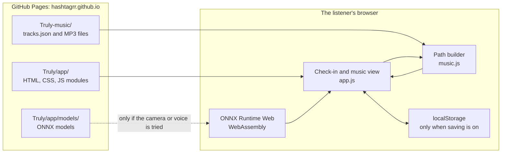
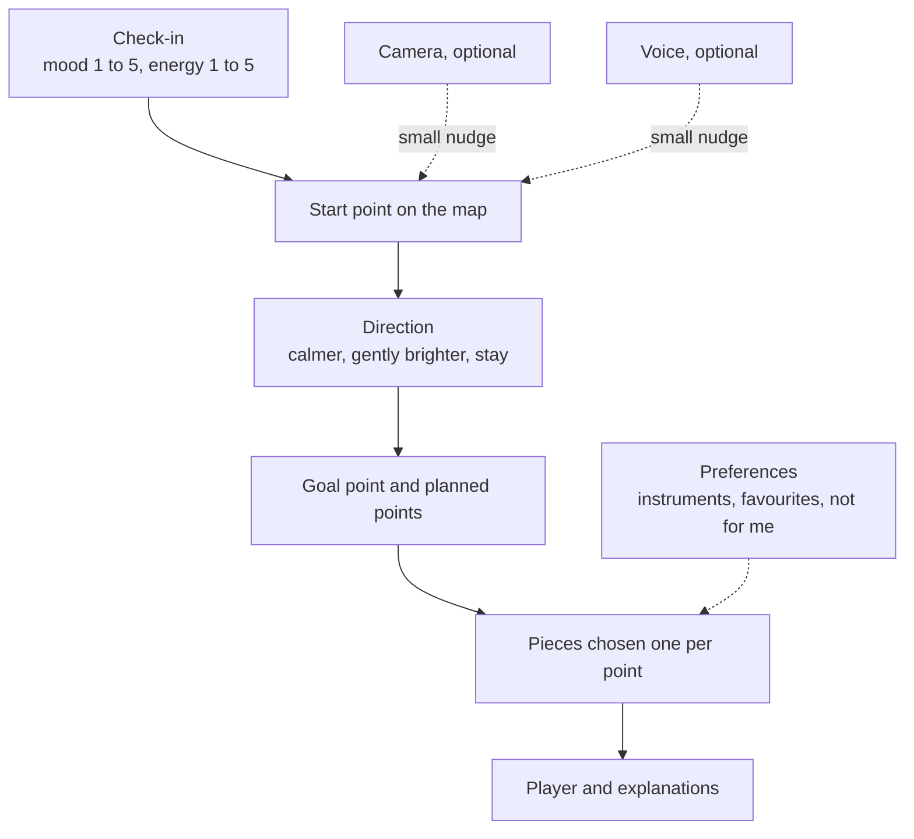
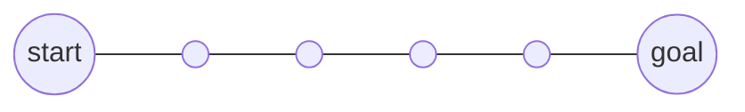
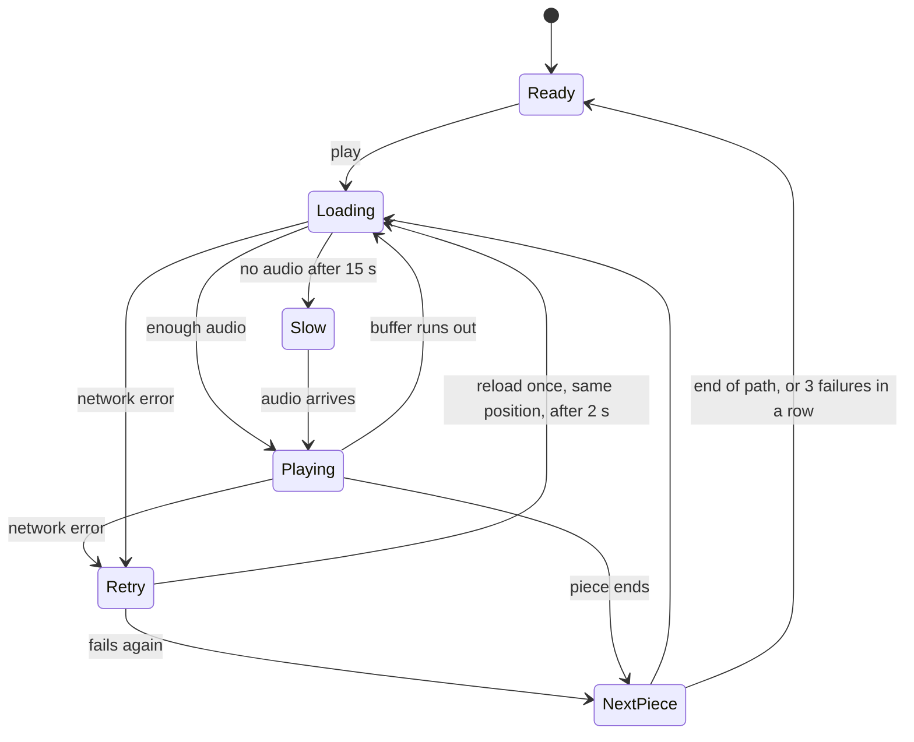
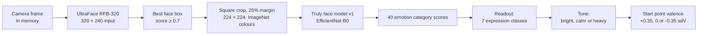
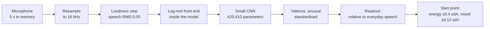
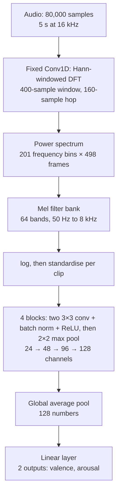
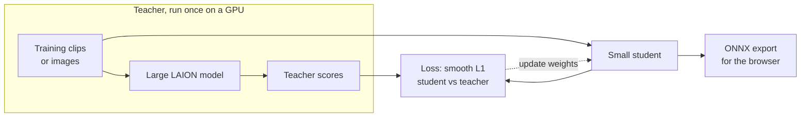
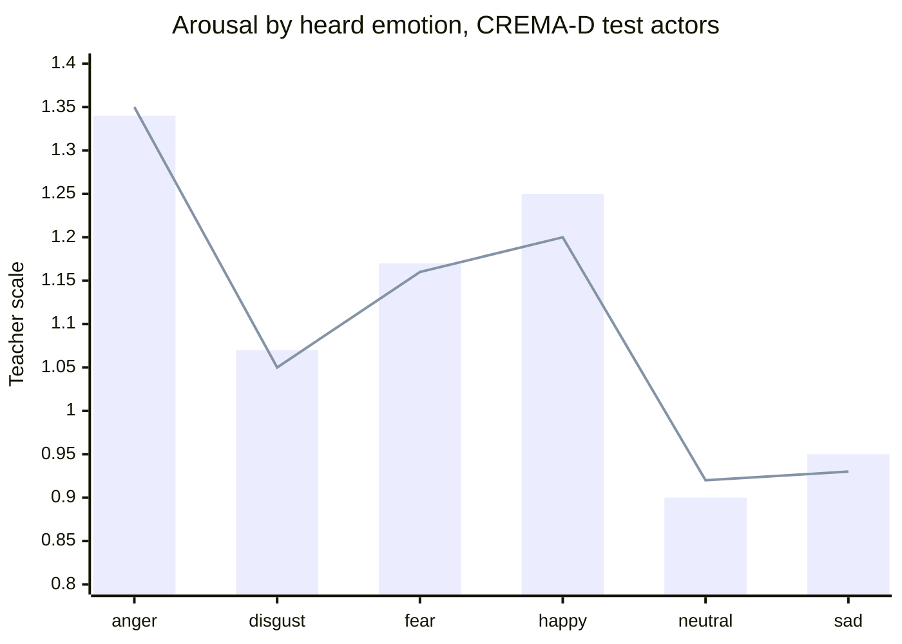
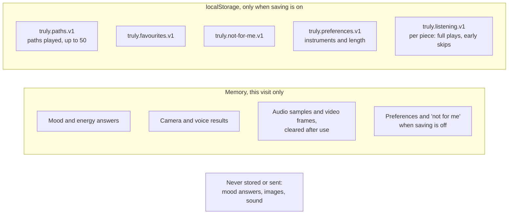

# How Truly works

This is a blueprint of Truly for people who want to read, change or learn from the code. It follows one listening session from the check-in to the last piece, and then opens up the two on-device models: how they run in the browser and how they were trained.

A visual version of this page, with live charts drawn by the app's own code, is on the website: [hashtagrr.github.io/Truly/how-it-works.html](https://hashtagrr.github.io/Truly/how-it-works.html).

## Contents

1. [The big picture](#1-the-big-picture)
2. [The map: mood and energy as numbers](#2-the-map-mood-and-energy-as-numbers)
3. [From answers to a path](#3-from-answers-to-a-path)
4. [Choosing each piece](#4-choosing-each-piece)
5. [Explaining each piece](#5-explaining-each-piece)
6. [The player](#6-the-player)
7. [The camera input](#7-the-camera-input)
8. [The voice input](#8-the-voice-input)
9. [How the models were trained](#9-how-the-models-were-trained)
10. [What is stored, and where](#10-what-is-stored-and-where)
11. [Code map](#11-code-map)

## 1. The big picture

Truly is a static website. There is no server code, no database and no account: the browser downloads plain HTML, CSS and JavaScript modules, the music list and, only if the listener tries them, two small machine learning models. Everything after that happens on the listener's device.



Two repositories make up the site. [Truly](https://github.com/hashtagRR/Truly) holds the app, the models, the training code and the documents. [Truly-music](https://github.com/hashtagRR/Truly-music) holds the recordings and `tracks.json`. Both are served from the same GitHub Pages domain, so the app can fetch the music without any cross-site requests.

A session moves through five stages:



The listener's own answers always lead. The camera and voice can only move the start point by a small, capped amount, and preferences can only tilt the choice between pieces that already fit the path.

## 2. The map: mood and energy as numbers

Truly places both people and music on one two-dimensional map (Russell, 1980):

- **Valence**: how pleasant or bright something feels, from low to high.
- **Arousal**: how lively or energetic it is, from calm to excited.

Each recording takes its valence, arousal and tempo from MCUD 1.0 (Du et al., 2026), a published dataset of music used in studies. Truly does not guess these values. When one recording stands for several MCUD entries, the values are averaged.

The check-in answers are turned into a point on the same map using the catalogue's own spread. Each answer from 1 to 5 picks a quantile of the catalogue's valence (for mood) or arousal (for energy):

| Answer | 1 | 2 | 3 | 4 | 5 |
|---|---|---|---|---|---|
| Quantile of the catalogue | 8% | 25% | 50% | 75% | 92% |

So "3" for mood means "the median valence of the music Truly has", whatever that collection contains. This keeps every answer reachable, even with a small catalogue.

Distances on the map are measured in standard deviations of the catalogue (`sdV` for valence, `sdA` for arousal), so that one step of mood and one step of energy count the same.

## 3. From answers to a path

### Direction and goal

The listener chooses a direction. Truly suggests one (`defaultDirection`): calmer when mood is low and energy high, staying when mood is already high, and gently brighter otherwise. The listener can always change it.

Each direction moves mainly one thing (`goalPoint` in `music.js`):

| Direction | Valence (mood) | Arousal (energy) |
|---|---|---|
| Calmer | lifts 40% of the way towards the 55% quantile, never down | drops to the 25% quantile, never up |
| Gently brighter | rises to at least the 70% quantile | moves 40% of the way towards the 45% quantile |
| Stay where I am | stays | stays |

### Planned points

`pathPoints` draws a straight line from the start to the goal and places one point per piece: 4, 6 or 9 points depending on the chosen length. "Slow down" keeps the first piece and spreads the same journey over half as many points again (for example 6 becomes 9), so each step is smaller.



This is the iso principle, a sequencing idea from music therapy practice (Heiderscheit and Madson, 2015): begin near the listener's current mood and move gradually. An experiment with listeners found that music ordered this way changed their affective state over the course of listening (Starcke and von Georgi, 2024). Truly borrows the sequencing idea only; it makes no claims about health.

## 4. Choosing each piece

`buildPath` walks along the planned points and, at each one, asks `pick` for the best piece. `pick` gives every remaining piece a cost; lower is better. With the piece's position `(v, a)`, the planned point `(pv, pa)`, the previous piece `(qv, qa)` and everything measured in catalogue standard deviations:

```
cost = (v - pv)² + (a - pa)²                        closeness to the planned point
     + 0.35 × [(v - qv)² + (a - qa)²]              a small step from the previous piece
     + 1.0 × (backward part of that step)²         no movement against the path's direction
     + 0.3 × ((tempo - previous tempo) / 30 bpm)²   gradual tempo changes
     + 0.6   if it has none of the preferred instruments
     - 0.25  if it is a favourite
     ± 0.24  at most, from listening counts: pieces usually played to the end are a little cheaper, pieces usually left early a little dearer
```

Listening counts are kept per piece only while saving is on. Leaving a piece by choice in its first 30 seconds (Next, Previous, playing another piece, or swapping it) counts as an early skip; reaching the end counts as a full play. Stopping, starting a new path and pieces that fail to load do not count. The difference is capped at three either way. "Your listening" shows the counts and can forget them.

`pathQuality` measures how gradual a path is: the average and largest step between neighbouring pieces in catalogue standard deviations, the step variation (spread of step sizes over their average) and the largest tempo change. These follow the smoothness and even-step ideas used to judge mood playlists (Donnelly and Gaur, 2022). Tests keep every path within today's limits.

Three hard rules come first: a piece already in the path, a performer already in the path, and a piece marked "not for me" are never chosen.

To keep paths from always being identical, Truly keeps the eight cheapest pieces and then picks among the closest few:


The best match is chosen most of the time, and near-ties sometimes swap. Finally `forwardOrder` sorts the whole path by its position along the direction of travel, so even when a later point found a piece that sits slightly behind an earlier one, the path never steps backwards.

**Swapping a piece** (`replaceSong`) runs the same choice for one point, but only accepts pieces that sit between its neighbours along the direction. If nothing fits there, it relaxes that bound and reorders the path afterwards.

The tests in `tests/music.test.mjs` check these rules for every combination of answers and directions: the right length, no repeated performer, always forwards, including after swaps and slowing down.

## 5. Explaining each piece

`explain` writes one sentence per piece from its place in the path. The first piece is "Chosen to match the mood and energy you described." Every later piece is compared with the one before it: a change of more than 0.15 standard deviations in arousal reads as "calmer" or "livelier", and in valence as "brighter" or "more reflective". The last piece of a moving path adds "This is where the path settles." When a preference applies, a short note follows, such as "Features piano, as you asked." or "One of your favourites."

## 6. The player

The player is a single `<audio>` element driven by `app.js`. It is built to keep going on poor connections:



- The music list is fetched with a 10 second timeout and up to three attempts, then a "Try again" button.
- When a piece can play through, the next piece starts downloading in the background.
- The position slider is keyboard friendly: arrow keys move 10 seconds, Page Up and Page Down 30.
- The Media Session API puts the title and play, pause, next and previous controls on phone lock screens and headsets.

## 7. The camera input

The camera is optional, off until tried, and only adds or subtracts a small amount of valence at the start of the path. Faces are not a reliable guide to feelings (Barrett et al., 2019), so the result is presented as a playful guess.



Step by step (`face.js` and `readout.js`):

1. **Find the face.** A frame is drawn to a 320 × 240 canvas and passed to UltraFace, a 1 MB face detector. It returns 4,420 candidate boxes; the most confident one above 0.7 is used.
2. **Crop.** A square around the face, 25% larger on each side, is resized to 224 × 224 and normalised with the ImageNet mean and standard deviation.
3. **Score.** The Truly face model returns 40 standardised scores, one per emotion category of the EmoNet-Face taxonomy.
4. **Read out.** The scores are turned back to the teacher's scale (`target_std`, `target_mean`), averaged within each of seven expression groups (angry, disgust, fear, happy, neutral, sad, surprise), neutral is scored as minus the strongest emotional group, and calibration offsets are added.
5. **Average.** Up to ten frames, 0.4 seconds apart, are averaged; fewer than three usable frames gives no result.
6. **Tone.** Happy and surprise read as "bright", angry, disgust, fear and sad as "heavy", neutral as "calm". Bright moves the start up by 0.35 standard deviations of valence, heavy down by the same amount, calm not at all. Energy is never changed by the camera.

The video never leaves the page, no frame is stored, and the camera stops after the reading.

## 8. The voice input

The voice input is optional, off until tried, and listens to the sound of the voice, never the words. Nothing is transcribed. It nudges mainly the starting energy, and mood only lightly.



### Recording and the loudness step

`voice.js` records five seconds through the Web Audio API with echo cancellation on and noise suppression and automatic gain off, so the model hears the voice as it is. The audio is resampled to 16 kHz with an `OfflineAudioContext`.

A voice close to a phone and a voice across the room differ in loudness far more than they differ in expression, so the same loudness step used in training is applied here (`normalise`):

1. Split the clip into 25 ms frames (400 samples) and measure each frame's RMS.
2. Keep the "sounding" frames, those above 10% of the loudest frame.
3. If even the loudest frame is below 0.002, there is too little sound: no result.
4. Scale the clip so the sounding frames reach an RMS of 0.05, but never let a peak pass 0.99.

The recording buffers are overwritten with zeros as soon as the model has run.

### Inside the model

The whole signal path, including the spectrogram, is inside the ONNX file, so the browser only passes raw samples in. A spectrogram turns sound into a picture of which pitches are present over time; the model reads that picture.



The discrete Fourier transform is written as a one-dimensional convolution whose 402 filters are the cosine and sine waves for each frequency bin, multiplied by a Hann window. Those filters, and the mel filter bank, are fixed buffers rather than trained weights. This keeps the model exportable to standard ONNX operators that ONNX Runtime Web runs everywhere. Standardising each clip's log-mel picture removes any remaining level difference, and global average pooling lets the network judge the clip as a whole rather than one moment.

### Readout

The model outputs two numbers in standard deviations of its training targets. `truly-voice-v1-readout.json` converts them so that 0 means "about as lively, or as bright, as everyday speech", using the teacher's average on natural speech from Emolia YODAS. Each value is capped at ±1.5, scaled to ±1, and moves the start point by at most 0.4 standard deviations of the catalogue's arousal and 0.12 of its valence. Energy leads because the teacher's valence depends mostly on words, which Truly never uses.

## 9. How the models were trained

Both models are students distilled from larger LAION teacher models. Distillation means the small model learns to reproduce the big model's outputs on many examples, so the knowledge fits in a size that runs in a browser. All training ran as Kaggle notebooks (`training/`), and only non-clinical outputs of the teachers were ever computed.



### Face model

| | |
|---|---|
| Teacher | Empathic-Insight-Face-Large: 40 MLPs on SigLIP 2 so400m image embeddings (CC BY 4.0) |
| Student | EfficientNet-B0, about 4.1 million parameters, 16.2 MB |
| Images | 79,999 from FairFace and EmoNet-Face Big and Binary |
| Training | 8 epochs, AdamW, one-cycle learning rate, augmentation for crops, flips, rotation, greyscale, low resolution and lighting |
| Calibration | Class offsets fitted on CREMA-D video frames of actors with even identifiers |
| Result | 59.5% accuracy on FER+ PrivateTest; Spearman 0.458 with expert ratings on EmoNet-Face HQ |

### Voice model

| | |
|---|---|
| Teacher | Empathic-Insight-Voice-Small Valence and Arousal heads on BUD-E-Whisper embeddings (CC BY 4.0) |
| Student | The log-mel CNN above, 420,410 parameters, 2.4 MB |
| Audio | 12,932 five-second windows from LAION's Got Talent, Emolia YODAS and CREMA-D even-numbered actors |
| Training | 30 epochs, AdamW, one-cycle learning rate, time shift, gain and background noise augmentation |
| Result | Correlation with the teacher's arousal: 0.90 on validation, 0.79 on CREMA-D actors never seen in training |

The student's average arousal for each emotion that listeners heard in CREMA-D clips follows the teacher closely:



Bars are the teacher, the line is the student. Full details are in the [face model card](../models/face/MODEL_CARD.md) and the [voice model card](../models/voice/MODEL_CARD.md).

### Running models in the browser

Both models run with ONNX Runtime Web 1.30.0 on its WebAssembly backend, with one thread so the page works without special server headers. The runtime and models load only when the listener first tries the camera or voice. `tests/models.test.mjs` loads each shipped model with the same runtime in Node.js and checks the input and output shapes the app relies on.

## 10. What is stored, and where



Saving is off by default (`truly.saving.v1` is absent). Switching it off stops new saves; the Privacy page can download or delete everything. Nothing is ever sent to a server, and the site uses no cookies, analytics or third-party requests.

## 11. Code map

| File | What it does |
|---|---|
| `docs/app/index.html` | The app's views: check-in, music, your listening, privacy |
| `docs/app/app.js` | Wires the views together: check-in, camera and voice, path, player, preferences, history |
| `docs/app/music.js` | Pure functions for the map, goals, planned points, piece choice, swaps, nudges and explanations |
| `docs/app/store.js` | The only code that touches `localStorage`: history, favourites, preferences and listening counts |
| `docs/app/face.js` | Camera, face detection and the face model |
| `docs/app/readout.js` | Turns face model output into a tone; pure functions |
| `docs/app/voice.js` | Microphone, loudness step and the voice model |
| `docs/app/models/` | ONNX models and their readout settings |
| `training/face_teacher.py`, `training/face_distill.py` | Face teacher scores and distillation |
| `training/voice_teacher.py`, `training/voice_distill.py` | Voice teacher scores and distillation |
| `music/recordings.json`, `music/prepare_audio.py` | Which recordings make up the catalogue, and how they are prepared |
| `tests/` | Tests for paths, storage, readouts and models, run by GitHub Actions |

## References

The research and data behind these choices are listed in [RESEARCH.md](RESEARCH.md) and [DATASETS.md](DATASETS.md).
